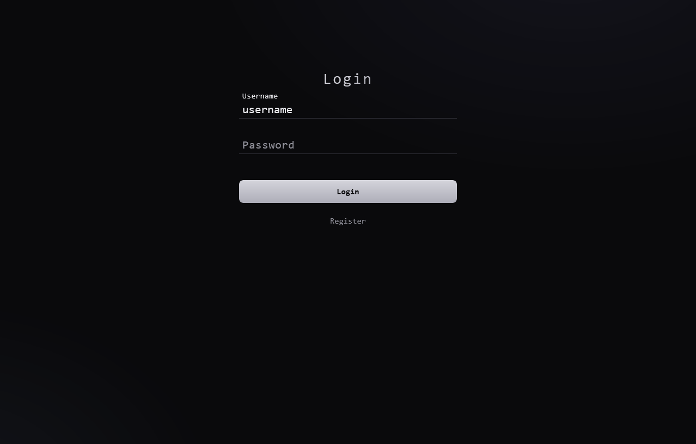
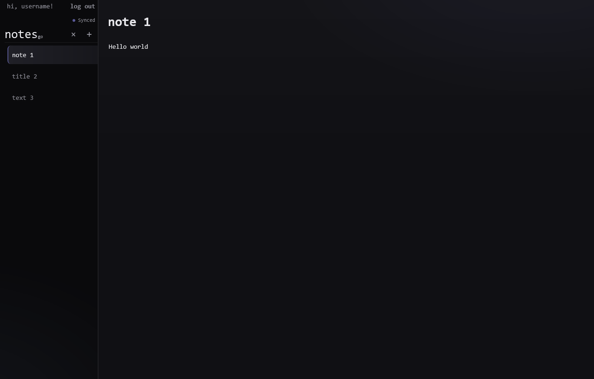

# notes-go

Self-hosted notes app with **end-to-end encryption**. The server never sees your note contents — encryption and decryption happen entirely in the browser.


---

## 🗒️ What is it

`notes-go` is a small, self-hosted note-taking web app written in Go.

- Notes are encrypted in the browser with **AES-256-GCM** before being sent to the server.
- The encryption key is derived from the user's password with **PBKDF2-SHA256** and a per-user salt, and kept **only in `sessionStorage`**.
- The server stores opaque ciphertext. It cannot read your notes.

The backend is a JSON API + static file server, fronted by nginx. Postgres is used for persistence, with schema managed by [goose](https://github.com/pressly/goose) migrations.

---

## Features

- 🔐 **End-to-end encryption** — AES-256-GCM in the browser, key never leaves the client
- 🔑 **Password-derived keys** — PBKDF2-SHA256
- 📝 **Rich note editing** — title + content, autosave with debounce
- 🔀 **Drag-and-drop reordering** — persisted server-side via `position`
- 🛡️ **Optimistic concurrency** — `version` column prevents lost updates (HTTP 409 on conflict)
- 🚪 **JWT auth** — httpOnly + Secure cookie, configurable TTL
- 🐳 **Docker Compose** — one command brings up Postgres, migrations, app, and nginx
- 🏗️ **Two build strategies** — `compile` (multi-stage Go build) or `local` (use pre-built binaries on low-power servers)

---

## 📸 Screenshots

| Login | Notes |
|-------|-------|
|  |  |

---

## 🚀 Quick start

### Prerequisites

- Docker Compose
- TLS certificates for nginx

### 1. Configure environment

Create a `.env` file in the project root:

```bash
# Database
DB_NAME = notes
DB_USER = notes
DB_PASSWORD = password
DB_PORT = 5432 # for backend debugging
FILE_SERVER = false # for backend debugging

# App
JWT_SECRET = a-long-random-string
JWT_ACCESS_EXPIRATION_MINUTES = 15
APP_PORT = 8080 # for backend debugging

# nginx
NGINX_HTTP_PORT = 80
NGINX_HTTPS_PORT = 443
HOST_CERTS_DIR = ./nginx/certs/
SSL_CERT_FILE = cert.pem
SSL_KEY_FILE = key.pem

# Docker
BUILD_STRATEGY = compile # "compile" (build Go inside Docker) or "local" (use ./bin/app & ./bin/migration)
```

### 2. Bring it up

```bash
docker compose up -d --build
```

Open `https://localhost` (or your configured host).

---

## 🔒 Security model

This is the part that matters most, so here's exactly what happens:

### Key derivation

1. User registers / logs in with a **username and password**.
2. The server generates a **16-byte random salt** (`notes_salt`) per user and stores it in Postgres.
3. The browser receives the salt, derives a key with **PBKDF2-SHA256**:
   - 600,000 iterations
   - 16-byte salt
   - 256-bit output, used as an **AES-GCM** key
4. The derived key is exported as JWK and stored in **`sessionStorage`** under `notesKey`.
   - It is **not** persisted to disk, **not** sent to the server, and cleared when the tab/session ends.

### Note encryption

For each note, the client:

1. Serializes `{title, content}` to JSON.
2. Generates a random **12-byte IV**.
3. Encrypts with **AES-256-GCM**.
4. Concatenates `IV ‖ ciphertext` and base64-encodes it.
5. Sends the base64 blob to the server.

The server stores and returns only that blob. It has no way to decrypt it — the key never leaves the browser.

### What the server knows

- Your username
- A **bcrypt/argon hash** of your login password (separate from the notes key — see note below)
- Your **notes salt** (public by design; salts aren't secret)
- Ciphertext blobs, their sizes, and metadata (`version`, `position`, timestamps)
- Note **titles are sent empty** in the current version — the server does not receive them.

> **Important:** the notes encryption key is derived from the same password used to log in.

### Transport & session

- JWT is delivered as an **`HttpOnly`, `Secure` cookie** — not readable from JS.
- All traffic between browser and nginx should be HTTPS (nginx is the TLS terminator).
- `logout` clears the cookie; the client also wipes `sessionStorage`.

### Concurrency

Writes are guarded by an optimistic lock: the client sends the current `version`, the server compares it, and returns **`409 Conflict`** if it doesn't match. The client surfaces this as `Sync Failed` — no automatic retry, so the user is always aware of a conflict.

---

## Database & migrations

Schema is managed with [goose](https://github.com/pressly/goose). Migrations live in `migrations/` and run automatically as a one-shot `migration` container before `app` starts (see `docker-compose.yml`).

---

## Architecture

- **nginx** terminates TLS, serves `/static/*` directly, and proxies `/api/*` and page routes to `app`.
- **app** is the Go HTTP server (`cmd/app`). It handles auth, notes CRUD, and serves HTML pages.
- **migration** is a one-shot container (`cmd/migration`) that runs goose migrations before the app starts. `app` waits for it via `depends_on: service_completed_successfully`.
- **db** is PostgreSQL 15 with a persistent named volume (`pgdata`).

---

## 📁 Project structure

```
cmd/
  app/          # HTTP server entry point
  migration/    # goose migration runner
docker/
  compile/      # multi-stage Dockerfile (builds Go inside Docker)
  local/        # Dockerfile that copies pre-built binaries from ./bin
internal/
  config/       # env loading
  domain/       # entities & sentinel errors
  repository/   # Postgres access (pgx)
  service/      # business logic
  transport/    # HTTP layer: routing helpers, JWT, middleware, handlers, responses
migrations/     # goose SQL migrations
nginx/          # nginx config + TLS certs
static/
  css/          # styles
  html/         # auth.html, notes.html
  js/           # frontend (Alpine.js + Web Crypto API)
```
